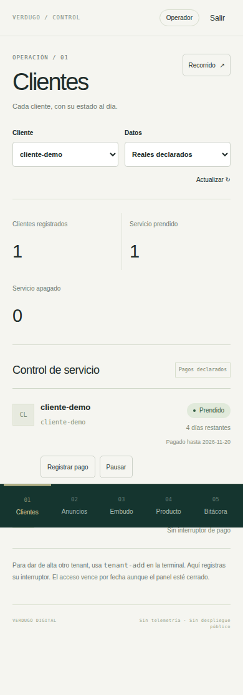
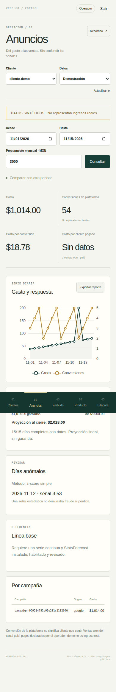
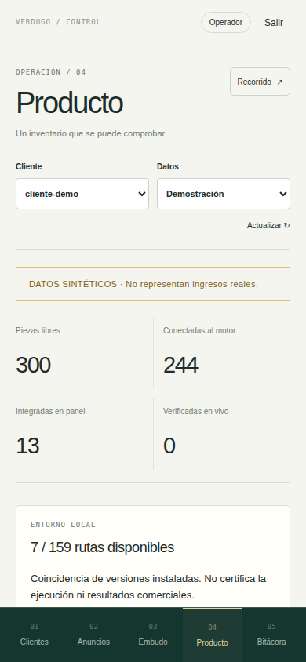

# Lote B: panel local

Depende del motor del PR #30. Ambas ramas apuntan a main para revisión; no se hizo merge.

El panel usa el mismo Engine y SQLite en cinco vistas: Clientes, Anuncios, Embudo,
Producto y Bitácora. Puerto local, token privado, rol fijo y confirmación para cambios.
Sin telemetría, servicios públicos, proveedores de pago ni datos reales.

## Conteo honesto

244 piezas conectadas al motor, 13 integradas en el panel, 43 piezas de construcción,
0 pendientes de conector, 22 excluidas por licencia y 0 verificadas en vivo.
**257/300 piezas con una ruta implementada; no se afirma 300/300 ni producción validada.**

El manifiesto sources/panel.json vincula fuente, versión, uso y prueba. La prueba
de integridad cruza las versiones con package.json/package-lock.json y, para FastAPI,
requirements.txt/constraints.txt. Una importación sin su llamada no basta.
La ejecución se verifica con Vitest, API y navegador en CI.

## Los 56 componentes

| Componente | Integrado | Uso o motivo |
|---|---|---|
| astro | Sí · 7.4.11 | Compila y sirve las vistas estáticas del panel. |
| grapesjs | No | No se editan sitios o plantillas: el panel tiene cinco vistas fijas. |
| react-email | No | No se envían correos desde este producto local. |
| crawlee | No | No hay una tarea autorizada de rastreo; los anuncios entran por CSV. |
| better-auth | No | El token local y el rol fijado al iniciar cubren este acceso; no hay cuentas web. |
| schema-dts | No | El panel privado no publica datos estructurados para buscadores. |
| web-vitals | Sí · 6.2.3 | Mide CLS, INP y LCP localmente sin enviar telemetría. |
| altcha | No | No hay formularios públicos expuestos a bots. |
| cookieconsent | No | No usa cookies ni rastreadores que requieran un gestor de consentimiento. |
| libphonenumber | No | No se capturan teléfonos en estas cinco pantallas. |
| id-openstreetmap | No | No se edita cartografía de OpenStreetMap. |
| feed | Sí · 6.0.0 | Exporta los eventos proyectados a RSS local. |
| carousel-generator | No | No hay creación de carruseles en el alcance del panel. |
| excalidraw | No | No hay un flujo de diagramación que justifique un lienzo adicional. |
| onlinewardleymaps | No | No se elaboran mapas de estrategia. |
| bpmn-js | No | No se editan procesos BPMN; las acciones son acotadas. |
| kepler-gl | No | No existe información geográfica que analizar. |
| squiggle | No | No hay un modelo probabilístico revisado; agregar uno inventaría supuestos. |
| marimo | No | Los análisis ya pasan por el motor; no hay notebooks editables en el panel. |
| mastra | No | No se añade otro motor de agentes ni autonomía al panel. |
| stagehand | No | No hay navegación autónoma ni sitios autorizados para automatizar. |
| mcp-typescript-sdk | No | El MCP stdio existente está en Python y no requiere otro servidor. |
| ag-ui | No | No hay una interfaz de agentes en tiempo real. |
| copilotkit | No | No se incorpora un asistente con permisos operativos. |
| vercel-ai-sdk | No | El panel consulta el motor local sin llamadas a modelos. |
| assistant-ui | No | No se necesita un chat para operar las cinco vistas. |
| trpc | No | La API delimitada de FastAPI ya resuelve la comunicación. |
| hono | No | FastAPI utiliza directamente Engine; un segundo servidor no añade una función. |
| fastapi | Sí · 0.162.7 | API local con roles, CSRF y el mismo Engine. |
| drizzle | No | Engine administra SQLite; no se agrega una capa de estado paralela. |
| nextjs | No | Astro proporciona el sitio estático; no se mezclan dos aplicaciones. |
| shadcn-ui | No | Los controles accesibles concretos no requieren incorporar otro sistema de componentes. |
| tailwindcss | Sí · 4.3.5 | Genera la cuadrícula adaptable de métricas. |
| refine | No | No se necesita un segundo marco de administración sobre las cinco vistas. |
| echarts | Sí · 6.1.0 | Grafica gasto y conversiones en dos ejes. |
| tanstack-query | Sí · 5.107.1 | Consulta, actualiza y aísla caché por tenant y dataset. |
| tanstack-table | Sí · 9.3.1 | Construye tablas reales de campañas e inventario. |
| i18next | Sí · 27.1.1 | Traduce navegación y estados al español. |
| scalar | No | La API no se publica; la guía operativa cubre su uso. |
| starlight | Sí · 0.43.1 | Compila la guía de operación en español. |
| bullmq | No | No hay trabajos en cola ni Redis; las operaciones son locales y acotadas. |
| uppy | No | La importación queda en la CLI con vista previa; no hay carga de archivos web. |
| sharp | No | No se procesan imágenes de clientes ni material creativo. |
| surveyjs | No | No se crean encuestas. |
| tiptap | No | No hay edición de texto enriquecido. |
| expo | No | El sitio adaptable ya se usa en teléfono; no se construye una app nativa. |
| hoppscotch | No | No se ofrece una consola de peticiones arbitrarias al operador. |
| zod | Sí · 4.6.7 | Valida pagos y filtros antes de enviarlos. |
| vitest | Sí · 5.1.0 | Ejecuta las pruebas de comportamiento de la interfaz. |
| instantsearch | No | Se filtran 300 entradas locales; no hay índice o servicio de búsqueda. |
| maplibre | No | Los datos no incluyen zonas verificadas; un mapa sería ficticio. |
| vite-pwa | No | El panel exige conexión al motor; no almacena datos privados en una caché offline. |
| driverjs | Sí · 1.14.0 | Recorrido de cliente, vistas y confirmaciones. |
| socketio | No | La actualización explícita y periódica es suficiente; no hay eventos por socket. |
| pdfme | No | El paquete del commit fijado declara 0.0.0 y se versiona al publicar. No se inventa una equivalencia npm; se exporta JSON. |
| evidence | No | Las gráficas consumen ads-report; no se crea otro sistema SQL o de informes. |

## Evidencia

Las capturas de teléfono en `docs/capturas-panel/` contienen solo datos sintéticos.
Las pruebas de navegador registran un cliente apagado, declaran su pago, comprueban
que se prende, adelantan un reloj exclusivo del fixture y ven que se apaga. El rol
viewer no ve controles de escritura. El servidor también rechaza sus mutaciones.
El reloj de producción no es modificable por HTTP.

La API prueba token, Host/Origin, CSRF, confirmación, tamaño, aislamiento y SQLite
compartido. No se conserva sesión ni reportes en localStorage, cookies o caché offline.
Los reportes y RSS descargados quedan bajo responsabilidad del operador.

## Validación observada

- 763 pruebas del núcleo; 8 de API; 11 de Vitest; 1 recorrido completo en navegador.
- Tipos TypeScript y compilación Astro/Starlight correctos.
- Recorrido observado en CI 43828575165, Chrome 157.0.8103.50, 390 × 844.
- Exportaciones JSON y RSS comprobadas, sin peticiones externas ni errores JavaScript.
- El navegador de este entorno local no pudo abrir su socket Unix; la ejecución
  real del navegador se comprobó en el job panel de GitHub, sobre 127.0.0.1.
- El diagnóstico sin ejecución ahora usa prepare, sin crear planes en SQLite.

## Límites

No se instalaron ni ejecutaron las 43 piezas que no aportan un uso honesto a estas
vistas. Su inclusión requeriría ampliar o cambiar el alcance. No hay validación de
cuentas reales ni mediciones de Codespaces. Pagos y ventas siguen siendo declaraciones
del operador, no comprobaciones bancarias. Consultar CI del commit exacto antes de revisar.
